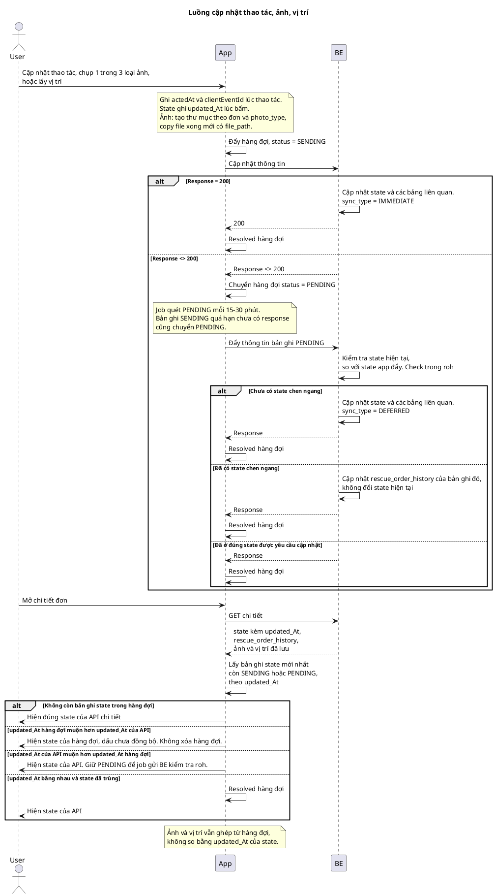

# Đồng bộ thao tác app tài xế khi mất kết nối


|           |                                                                      |
| --------- | -------------------------------------------------------------------- |
| Phiên bản | v.3                                                                  |
| Ngày      | 2026-10-15                                                           |
| Sequence  | [dong-bo-thao-tac-app-tai-xe.puml](dong-bo-thao-tac-app-tai-xe.puml) |


## Lịch sử


| Phiên bản | Nội dung                                                                                       |
| --------- | ---------------------------------------------------------------------------------------------- |
| v.1       | Khởi tạo tài liệu                                                                              |
| v.2       | Chia 3 loại ảnh và thư mục lưu file. Job quét 15–30 phút. DB ghi đồng bộ ngay hoặc đồng bộ sau |
| v.3       | Bổ sung mô tả từng bước của sequence                                                           |


## Tài liệu liên quan


| Tên                | Việc dùng                                                     |
| ------------------ | ------------------------------------------------------------- |
| Quản lý đơn cứu hộ | State đơn trên CMS, `rescue_order_v2`, `rescue_order_history` |
| App VETC Cứu hộ    | Nơi tài xế bấm trạng thái, chụp ảnh hiện trường, lấy vị trí   |


## 1. Phạm vi

Tài xế trên app VETC Cứu hộ thực hiện ba việc trong lúc đang cứu hộ:

- Chuyển trạng thái: Đã đến điểm cứu hộ, Bắt đầu kéo xe, Hoàn thành cứu hộ.
- Chụp ảnh, chia ba loại: Hiện trường sự cố, Quá trình xử lý, Hoàn tất cứu hộ.
- Lấy vị trí. Trong đơn, app lấy một điểm mỗi 5 giây.

Hàng đợi nằm trên máy tài xế. BE không giữ hàng đợi này. App ghi hàng đợi ngay khi thao tác xong, rồi mới gọi BE.

CMS và người khác vẫn đổi đơn trên server. App không ghi đè state server khi đã có state chen ngang.

## 2. Từ ngữ


| Từ                     | Nghĩa                                                                                                                                             |
| ---------------------- | ------------------------------------------------------------------------------------------------------------------------------------------------- |
| Hàng đợi               | SQLite trên máy app. Mỗi thao tác là một dòng.                                                                                                    |
| `client_event_id`      | Khóa app tạo lúc ghi hàng đợi. Một thao tác một khóa. BE gặp lại cùng khóa thì không ghi lần thứ hai.                                             |
| `acted_at`             | Giờ tài xế thao tác. Không thay bằng giờ BE nhận request.                                                                                         |
| `updated_at` của state | Giờ state được đổi, bằng lúc tài xế bấm. Không lấy giờ job quét, không lấy giờ chuyển `SENDING` sang `PENDING`.                                   |
| `SENDING`              | Dòng vừa ghi, app đang gọi BE lần đầu.                                                                                                            |
| `PENDING`              | Lần gọi không nhận 200, hoặc `SENDING` quá hạn chưa có response. Job quét các dòng này.                                                           |
| Resolved               | Xóa dòng khỏi hàng đợi. Ảnh thì xóa cả file đã copy.                                                                                              |
| State chen ngang       | `rescue_order_v2.state` hiện tại không còn là `from_state` app gửi, và cũng không phải `to_state` app yêu cầu. Thấy trong `rescue_order_history`. |
| `roh`                  | `rescue_order_history`.                                                                                                                           |
| `photo_type`           | Loại ảnh: `hien-truong`, `qua-trinh`, `hoan-tat`.                                                                                                 |
| `sync_type`            | Trên DB server. `IMMEDIATE` là lần gọi đầu trả 200. `DEFERRED` là job gửi sau từ dòng `PENDING`.                                                  |


Ba nút trạng thái:


| Nút                | `from_state`                                                                | `to_state`                    |
| ------------------ | --------------------------------------------------------------------------- | ----------------------------- |
| Đã đến điểm cứu hộ | `DRIVER_ON_THE_WAY`                                                         | `RESCUE_IN_PROGRESS`          |
| Bắt đầu kéo xe     | `RESCUE_IN_PROGRESS`                                                        | `RESCUE_MOVE_TO_TOWING_POINT` |
| Hoàn thành cứu hộ  | `RESCUE_MOVE_TO_TOWING_POINT`, hoặc `RESCUE_IN_PROGRESS` nếu hỗ trợ tại chỗ | `RESCUE_COMPLETED_BY_DRIVER`  |


`COMPLETED` và `CANCELLED` do CMS hoặc OSA đặt, không phải nút trên app.

Ba loại ảnh:


| Loại              | `photo_type`  | Khi chụp                     |
| ----------------- | ------------- | ---------------------------- |
| Hiện trường sự cố | `hien-truong` | Vừa đến nơi                  |
| Quá trình xử lý   | `qua-trinh`   | Đang thao tác cứu hộ         |
| Hoàn tất cứu hộ   | `hoan-tat`    | Xử lý xong, trước khi rời đi |


Mỗi loại tối đa 4 ảnh trên một đơn. Hàng đợi và thư mục file tách theo `photo_type`. Không gộp chung một ngăn ảnh.

## 3. Bảng và trường

Hàng đợi không có trên server. Một đơn có nhiều dòng. App lọc theo `rescue_order_v2_id`.


| Cột trên máy             | Việc của nó                                                                  |
| ------------------------ | ---------------------------------------------------------------------------- |
| `client_event_id`        | Khóa duy nhất của thao tác                                                   |
| `rescue_order_v2_id`     | Đơn chứa thao tác                                                            |
| `kind`                   | `status`, `photo`, `location`                                                |
| `photo_type`             | Chỉ `kind` = `photo`: `hien-truong`, `qua-trinh`, `hoan-tat`                 |
| `seq`                    | Thứ tự các dòng `status` trong một đơn. Ảnh và vị trí không xếp bằng `seq`   |
| `from_state`, `to_state` | Chỉ `kind` = `status`                                                        |
| `acted_at`               | Giờ thao tác                                                                 |
| `updated_at`             | Giờ state đổi, dùng khi so với chi tiết đơn. Chỉ dòng `status`               |
| `status`                 | `SENDING` hoặc `PENDING`                                                     |
| `payload`                | Nội dung gửi BE: state, tọa độ, thông tin thiết bị                           |
| `file_path`              | Chỉ ảnh. Đường dẫn file đã copy xong. Có giá trị này rồi mới INSERT hàng đợi |


### 3.1. Thư mục ảnh trên máy

App tạo thư mục trong vùng lưu riêng, không tạo trong cache. Android lấy `filesDir`. iOS lấy Application Support.

```text
rescue-photos/{rescue_order_v2_id}/hien-truong/{client_event_id}.jpg
rescue-photos/{rescue_order_v2_id}/qua-trinh/{client_event_id}.jpg
rescue-photos/{rescue_order_v2_id}/hoan-tat/{client_event_id}.jpg
```


| Bước | Xử lý                                                                 |
| ---- | --------------------------------------------------------------------- |
| 1    | Tạo `rescue-photos` nếu chưa có                                       |
| 2    | Tạo thư mục `{rescue_order_v2_id}` nếu chưa có                        |
| 3    | Tạo thư mục đúng `photo_type` nếu chưa có                             |
| 4    | Copy file camera vào `{client_event_id}.jpg` trong thư mục đó         |
| 5    | `file_path` = đường dẫn tuyệt đối của file vừa copy                   |
| 6    | INSERT hàng đợi với `photo_type` và `file_path`, `status` = `SENDING` |


Copy lỗi hoặc chưa có `file_path` thì không INSERT hàng đợi và không coi là đã chụp xong. Resolved ảnh thì xóa đúng file tại `file_path`.

BE chỉ ghi database khi xử lý thành công.


| Bảng                     | Khi nào ghi                                                                                                                 |
| ------------------------ | --------------------------------------------------------------------------------------------------------------------------- |
| `rescue_order_v2`        | Đổi `state` khi chưa có state chen ngang                                                                                    |
| `rescue_order_history`   | Thêm mốc. Giờ mốc lấy `acted_at`. Nhánh state chen ngang vẫn ghi history của thao tác đó, không đổi `rescue_order_v2.state` |
| `ro_work_order`          | Cùng lần cập nhật state thành công                                                                                          |
| `ro_resource_work_order` | Cùng lần cập nhật state thành công. Dùng để biết tài xế còn được gán đơn hay không                                          |


Mỗi bản ghi BE tạo từ thao tác app có `sync_type`:


| `sync_type` | Khi nào                                      |
| ----------- | -------------------------------------------- |
| `IMMEDIATE` | Lần gọi đầu, app đang `SENDING`, BE trả 200  |
| `DEFERRED`  | Job gửi dòng `PENDING` và BE nhận thành công |


`sync_type` ghi trên dòng `rescue_order_history` của lần chuyển state, trên bản ghi ảnh, và trên bản ghi điểm vị trí. Không ghi đè `acted_at`. Ảnh lưu kèm `photo_type` để biết thuộc Hiện trường sự cố, Quá trình xử lý, hay Hoàn tất cứu hộ.

Ảnh và điểm vị trí đi theo API lưu ảnh và API lưu vị trí. Hai loại này không đổi `rescue_order_v2.state`.

## 4. Ghi hàng đợi và gọi BE lần đầu


| Bước             | Người làm | Xử lý                                                                                                                |
| ---------------- | --------- | -------------------------------------------------------------------------------------------------------------------- |
| Thao tác         | Tài xế    | Bấm nút trạng thái, chụp một trong ba loại ảnh, hoặc app lấy một điểm vị trí                                         |
| Ghi giờ          | App       | Ghi `acted_at`, `client_event_id`. Dòng state ghi `updated_at` lúc bấm. Ảnh làm xong mục 3.1 rồi mới có `file_path`  |
| Vào hàng đợi     | App       | INSERT dòng, `status` = `SENDING`. Ảnh kèm `photo_type`                                                              |
| Gọi BE           | App       | Gửi nội dung vừa ghi                                                                                                 |
| Thành công       | BE        | Response = 200. Ghi dữ liệu và `sync_type` = `IMMEDIATE`. Chuyển trạng thái thì cập nhật state và các bảng liên quan |
| Xong             | App       | Resolved hàng đợi                                                                                                    |
| Không thành công | BE        | Response <> 200. Chưa ghi state mới                                                                                  |
| Chờ gửi lại      | App       | UPDATE dòng, `status` = `PENDING`                                                                                    |


`SENDING` quá hạn mà chưa có response thì job chuyển dòng đó sang `PENDING`. App bị tắt giữa lúc chờ response vẫn còn dòng để gửi lại.

## 5. Job quét hàng đợi

Job nằm trên app. Quét định kỳ 15–30 phút một lần.

Job chỉ lấy dòng `PENDING`. Trước khi gọi, không tạo `client_event_id` mới. Gửi lại đúng khóa đã ghi lúc tài xế thao tác.


| `kind`     | Cách lấy                                                                                   | Cách gửi                                                                                             |
| ---------- | ------------------------------------------------------------------------------------------ | ---------------------------------------------------------------------------------------------------- |
| `status`   | Đúng `seq` trong từng `rescue_order_v2_id`. Dòng trước chưa resolved thì chưa lấy dòng sau | Một request: `client_event_id`, `from_state`, `to_state`, `acted_at`, `updated_at`                   |
| `photo`    | Các ảnh `PENDING` của đơn, giữ đúng `photo_type`                                           | Gửi file tại `file_path` kèm `client_event_id`, `photo_type` và `acted_at`. Chưa có ack thì giữ file |
| `location` | Gom điểm của đơn, sắp theo `acted_at`                                                      | Một lô. BE ack đến `client_event_id` nào thì xóa điểm đó                                             |


Năm lúc job chạy:

- Ngay sau khi một dòng chuyển thành `PENDING`.
- Máy vừa có mạng trở lại.
- Tài xế mở app hoặc đưa app lên nền trước.
- Định kỳ 15–30 phút một lần khi còn dòng `PENDING`.
- Mỗi lần lấy vị trí, nếu đã có điểm `PENDING`.

## 6. BE kiểm tra state khi nhận dòng PENDING

BE đọc `rescue_order_v2.state` hiện tại và `rescue_order_history`, rồi so với state app đẩy lên.


| Tình huống                                    | Xử lý trên BE                                                                                               | App               |
| --------------------------------------------- | ----------------------------------------------------------------------------------------------------------- | ----------------- |
| Chưa có state chen ngang                      | Cập nhật `state` và các bảng liên quan. History ghi mốc `acted_at`. `sync_type` = `DEFERRED`                | Resolved hàng đợi |
| Đã có state chen ngang                        | Cập nhật `rescue_order_history` của bản ghi đó, `sync_type` = `DEFERRED`. Không đổi `rescue_order_v2.state` | Resolved hàng đợi |
| State hiện tại đã bằng `to_state` app yêu cầu | Không ghi thêm một lần chuyển state                                                                         | Resolved hàng đợi |


Ảnh và vị trí không so state để quyết định hiện trên màn hình. Nếu đơn đã hủy hoặc đã đổi tài xế, BE từ chối gắn ảnh và điểm vào đơn đang chạy. App vẫn resolved dòng đó sau response, và báo tài xế.

## 7. Mở chi tiết đơn

API chi tiết trả state đang có trên BE, kèm `updated_at` của state, `rescue_order_history`, ảnh và vị trí đã lưu. API này không đọc hàng đợi trên máy.

App lấy dòng `status` mới nhất còn `SENDING` hoặc `PENDING` của đúng đơn, xếp theo `updated_at`.


| So sánh                                             | Màn hình                                     | Hàng đợi                                   |
| --------------------------------------------------- | -------------------------------------------- | ------------------------------------------ |
| Không còn dòng state                                | Hiện state của API chi tiết                  | Không đụng                                 |
| `updated_at` hàng đợi muộn hơn `updated_at` của API | Hiện state của hàng đợi, có dấu chưa đồng bộ | Giữ nguyên                                 |
| `updated_at` của API muộn hơn `updated_at` hàng đợi | Hiện state của API                           | Giữ `PENDING` để job gửi BE kiểm tra `roh` |
| Hai `updated_at` bằng nhau và state đã trùng        | Hiện state của API                           | Resolved                                   |


Ví dụ: API chi tiết có `updated_at` = `2026-10-10 10:01:00`, hàng đợi có `updated_at` = `2026-10-10 10:01:11`. Màn hình lấy state của hàng đợi.

Ảnh đang `SENDING` hoặc `PENDING` ghép thêm đúng nhóm `photo_type` bên cạnh ảnh API đã trả. Điểm vị trí trong hàng đợi ghép thêm nếu mới hơn điểm BE đã lưu. Hai loại này không so bằng `updated_at` của state.

## 8. Sequence

Mở file [dong-bo-thao-tac-app-tai-xe.puml](dong-bo-thao-tac-app-tai-xe.puml) bằng PlantUML. Sequence có hai đoạn: tài xế thao tác, rồi mở chi tiết đơn.

### 8.1. Tài xế cập nhật thao tác, ảnh hoặc vị trí

User gửi cho App một trong ba việc: chuyển trạng thái, chụp một trong ba loại ảnh, hoặc lấy vị trí.


| Bước | Ai         | Sequence                                                    | Mô tả                                                                                         |
| ---- | ---------- | ----------------------------------------------------------- | --------------------------------------------------------------------------------------------- |
| 1    | User → App | Cập nhật thao tác, chụp 1 trong 3 loại ảnh, hoặc lấy vị trí | Tài xế bấm nút, chụp ảnh, hoặc app lấy một điểm vị trí                                        |
| 2    | App        | Ghi `acted_at`, `client_event_id`, `updated_at`             | Ghi lúc thao tác. Ảnh tạo thư mục theo đơn và `photo_type`, copy file xong mới có `file_path` |
| 3    | App → App  | Đẩy hàng đợi, `status` = `SENDING`                          | INSERT dòng trên SQLite của máy                                                               |
| 4    | App → BE   | Cập nhật thông tin                                          | Gửi đúng dòng vừa ghi                                                                         |


Nhánh response = 200:


| Bước | Ai        | Sequence                                                        | Mô tả                                                                                                                                                                                                       |
| ---- | --------- | --------------------------------------------------------------- | ----------------------------------------------------------------------------------------------------------------------------------------------------------------------------------------------------------- |
| 5    | BE → BE   | Cập nhật state và các bảng liên quan. `sync_type` = `IMMEDIATE` | Lần gọi đầu thành công nên ghi đồng bộ ngay. Chuyển trạng thái thì cập nhật `rescue_order_v2`, `rescue_order_history`, `ro_work_order`, `ro_resource_work_order`. Ảnh ghi kèm `photo_type`. Vị trí ghi điểm |
| 6    | BE → App  | 200                                                             | Báo đã nhận                                                                                                                                                                                                 |
| 7    | App → App | Resolved hàng đợi                                               | Xóa dòng. Ảnh thì xóa file tại `file_path`                                                                                                                                                                  |


Nhánh response <> 200:


| Bước | Ai        | Sequence                                                         | Mô tả                                                                              |
| ---- | --------- | ---------------------------------------------------------------- | ---------------------------------------------------------------------------------- |
| 5    | BE → App  | Response <> 200                                                  | Chưa ghi state mới                                                                 |
| 6    | App → App | Chuyển hàng đợi `status` = `PENDING`                             | Giữ `client_event_id` cũ. `SENDING` quá hạn chưa có response cũng chuyển `PENDING` |
| 7    | App       | Job quét                                                         | Mỗi 15–30 phút, và khi vừa có `PENDING`, khi có mạng, hoặc khi mở app              |
| 8    | App → BE  | Đẩy thông tin bản ghi `PENDING`                                  | Gửi lại đúng khóa lúc tài xế thao tác                                              |
| 9    | BE → BE   | Kiểm tra state hiện tại, so với state app đẩy. Check trong `roh` | Đọc `rescue_order_v2.state` và `rescue_order_history`                              |


Ba kết quả của bước 9:


| Kết quả                               | Sequence                                                                 | Mô tả                                                                                                | Việc tiếp                              |
| ------------------------------------- | ------------------------------------------------------------------------ | ---------------------------------------------------------------------------------------------------- | -------------------------------------- |
| Chưa có state chen ngang              | Cập nhật state và các bảng liên quan. `sync_type` = `DEFERRED`           | State server vẫn là `from_state` app gửi                                                             | BE trả response. App resolved hàng đợi |
| Đã có state chen ngang                | Cập nhật `rescue_order_history` của bản ghi đó, không đổi state hiện tại | CMS hoặc người khác đã đổi state sang nhánh khác. History vẫn ghi thao tác, `sync_type` = `DEFERRED` | BE trả response. App resolved hàng đợi |
| Đã ở đúng state được yêu cầu cập nhật | Response                                                                 | `rescue_order_v2.state` đã bằng `to_state`. Không ghi thêm một lần chuyển                            | App resolved hàng đợi                  |


### 8.2. Mở chi tiết đơn

Đoạn này chạy khi tài xế mở đơn, kể cả khi hàng đợi còn `SENDING` hoặc `PENDING`.


| Bước | Ai         | Sequence                                                                   | Mô tả                                                    |
| ---- | ---------- | -------------------------------------------------------------------------- | -------------------------------------------------------- |
| 1    | User → App | Mở chi tiết đơn                                                            | Tài xế vào màn đơn                                       |
| 2    | App → BE   | GET chi tiết                                                               | API không đọc SQLite trên máy                            |
| 3    | BE → App   | State kèm `updated_at`, `rescue_order_history`, ảnh và vị trí đã lưu       | Đây là dữ liệu đã commit trên server                     |
| 4    | App → App  | Lấy bản ghi state mới nhất còn `SENDING` hoặc `PENDING`, theo `updated_at` | Chỉ dòng `kind` = `status` của đúng `rescue_order_v2_id` |


Bốn nhánh sau bước 4:


| Nhánh                                               | Sequence                                                       | Màn hình                                              |
| --------------------------------------------------- | -------------------------------------------------------------- | ----------------------------------------------------- |
| Không còn bản ghi state trong hàng đợi              | Hiện đúng state của API chi tiết                               | State server                                          |
| `updated_at` hàng đợi muộn hơn `updated_at` của API | Hiện state của hàng đợi, dấu chưa đồng bộ. Không xóa hàng đợi  | State tài xế vừa bấm                                  |
| `updated_at` của API muộn hơn `updated_at` hàng đợi | Hiện state của API. Giữ `PENDING` để job gửi BE kiểm tra `roh` | State server, vì có người đổi sau thao tác của tài xế |
| `updated_at` bằng nhau và state đã trùng            | Resolved hàng đợi, rồi hiện state của API                      | State server. Dòng local không còn việc               |


Ảnh và vị trí vẫn ghép từ hàng đợi theo `photo_type` và theo điểm mới hơn. Không dùng `updated_at` của state để chọn ảnh hay điểm vị trí.



